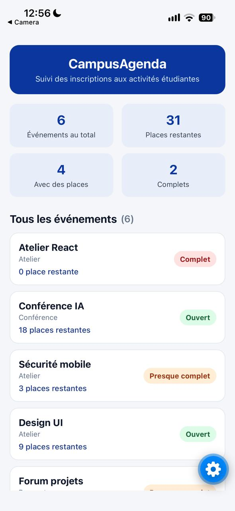
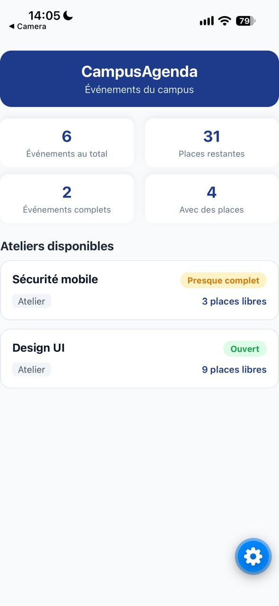

# TP3 Autonome - CampusAgenda (React Native & TypeScript)

Application mobile développée avec Expo et TypeScript dans le cadre du module Développement Mobile (IAIL S5 - FSA Ouarzazate).

## Architecture et Composants

* **`BadgeEtat`** : Composant réutilisable qui reçoit le statut (`Complet`, `Presque complet`, `Ouvert`) via ses props typées et adapte dynamiquement son texte et ses couleurs.
* **`BlocStatistique`** : Affiche un indicateur clé (libellé et valeur numérique) sous forme de carte afin d'éviter la duplication de code JSX dans le tableau de bord.
* **`CarteEvenement`** : Reçoit un objet `Evenement`, les places libres et le statut via les props pour afficher proprement chaque activité sans dépassement sur petit écran.
* **Utilisation de `FlatList`** : Permet d'afficher la liste filtrée de manière performante grâce à `data`, `renderItem`, un `keyExtractor` basé sur l'`id` unique de l'événement, ainsi que `ListEmptyComponent` pour gérer l'affichage lorsque la liste est vide.

## Captures d'écran

### Mode `'tous'` (6 événements)

### Mode `'ateliers'` (2 ateliers disponibles)
